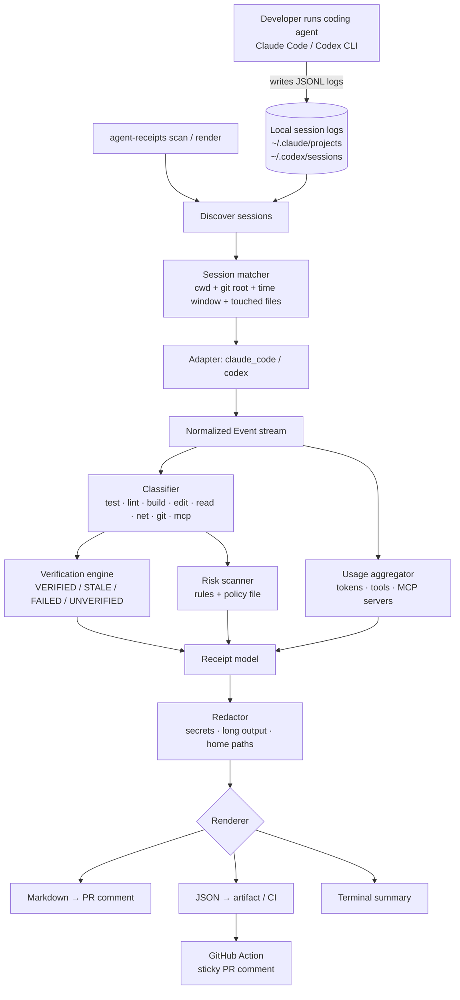

# Architecture — agent-receipts

Local-first Python CLI. No server, no database, no network calls except optional posting to GitHub via the user's own `gh` CLI or the Action's `GITHUB_TOKEN`.

## 1. App flow



## 2. System architecture

| Layer | Module | Responsibility |
|---|---|---|
| Ingest | `adapters/` | One adapter per harness. Reads raw JSONL line by line (streaming, never loads whole file), yields `Event` objects. Unknown line types → `Event(kind="unknown")`, never crash. |
| Match | `discovery.py` | Finds candidate session files, filters by `cwd` under the git root, time window (`--since`, default 24h) and overlap with `git diff --name-only`. |
| Analyse | `classify.py` | Labels each command/tool call (test, lint, build, git, net-install, fs-destructive, secret-read, mcp, edit, read). Uses built-in patterns + `.agent-receipts.toml`. |
| Analyse | `verify.py` | Walks the timeline: finds last `edit` event and the last `test`/`lint` events and their exit codes → verdict. |
| Analyse | `risk/` | Rule engine. Each rule = id, severity, matcher(event) → Finding with event index + evidence snippet. |
| Analyse | `usage.py` | Sums tokens per model, counts tool calls, lists MCP servers/tools. |
| Output | `redact.py` | Regex + Shannon-entropy secret detection, output truncation (default 400 chars), `$HOME` → `~`. Runs on the Receipt *before* any renderer. |
| Output | `render/` | `markdown.py` (Jinja2 template), `json_out.py`, `terminal.py` (Rich). |
| Interface | `cli.py` | Typer app: `scan`, `render`, `ls`, `rules`. |
| CI | `action/action.yml` | Composite GitHub Action: install package, render from uploaded JSON receipt, post/update sticky comment via `gh api`. |

## 3. Folder and file structure

```
agent-receipts/
├── README.md · LICENSE · PRD.md · Architecture.md · Rules.md · Phases.md · Design.md · Memory.md
├── pyproject.toml                 # package metadata, deps, ruff/pytest config
├── .agent-receipts.example.toml   # sample policy file
├── src/agent_receipts/
│   ├── __init__.py                # __version__
│   ├── __main__.py                # python -m agent_receipts
│   ├── cli.py                     # Typer commands
│   ├── models.py                  # Event, Finding, Verdict, Receipt (pydantic)
│   ├── discovery.py               # locate + match sessions to repo
│   ├── classify.py
│   ├── verify.py
│   ├── usage.py
│   ├── redact.py
│   ├── policy.py                  # load .agent-receipts.toml
│   ├── adapters/
│   │   ├── __init__.py            # registry + auto-detect
│   │   ├── base.py                # Adapter protocol
│   │   ├── claude_code.py
│   │   └── codex.py
│   ├── risk/
│   │   ├── __init__.py
│   │   ├── engine.py
│   │   └── rules.py               # built-in rules
│   └── render/
│       ├── markdown.py
│       ├── templates/receipt.md.j2
│       ├── json_out.py
│       └── terminal.py
├── tests/
│   ├── fixtures/                  # anonymised sample sessions (*.jsonl)
│   ├── test_adapters.py
│   ├── test_verify.py
│   ├── test_risk.py
│   └── test_redact.py
├── action/action.yml
└── .github/workflows/ci.yml
```

## 4. Tech stack (and why)

| Choice | Why |
|---|---|
| **Python 3.11+** | Fast to build, great JSON/streaming support, author's strongest language, easy `pipx install`. |
| **Typer** | Type-hinted CLI with auto help; less boilerplate than argparse. |
| **Pydantic v2** | Validated, versioned data model; free JSON schema export for the receipt format. |
| **Rich** | Readable terminal tables/colour for `scan` and `ls`. |
| **Jinja2** | Markdown/HTML templates kept out of Python code. |
| **tomllib (stdlib)** | Policy file parsing with zero extra deps. |
| **pytest + ruff + mypy** | Tests, lint/format, and type checks in one fast toolchain. |
| **GitHub Actions + `gh`** | Posting comments without hosting anything. |

No database: receipts are files. No LLM dependency in MVP.

## 5. Data model

```python
class Event(BaseModel):
    idx: int                      # position in session
    ts: datetime | None
    harness: Literal["claude_code", "codex"]
    kind: Literal["user_msg","agent_msg","command","file_edit","file_read",
                  "mcp_call","web","plan","usage","unknown"]
    command: str | None = None    # shell command text
    exit_code: int | None = None
    paths: list[str] = []         # files read/edited
    tool: str | None = None       # e.g. "Bash", "Edit", "mcp:github/create_pr"
    output_excerpt: str | None = None
    tokens: dict[str, int] = {}   # input/output/cached/reasoning
    labels: set[str] = set()      # filled by classifier

class Finding(BaseModel):
    rule_id: str                  # e.g. "FS001"
    severity: Literal["info","low","medium","high","critical"]
    event_idx: int
    title: str
    evidence: str                 # redacted snippet

class Verdict(BaseModel):
    status: Literal["VERIFIED","STALE","FAILED","UNVERIFIED"]
    last_edit_idx: int | None
    last_check_idx: int | None
    checks: list[str]             # commands counted as checks
    reason: str

class Receipt(BaseModel):
    schema_version: str = "1"
    repo: str; branch: str; head_sha: str | None
    sessions: list[SessionRef]    # harness, id, started_at, ended_at, model(s)
    files_changed: list[str]
    verdict: Verdict
    findings: list[Finding]
    usage: UsageSummary           # tokens per model, tool counts, mcp servers
    assumptions: list[str]        # agent_msg lines matching "I assume|assuming|TODO"
    generated_at: datetime
    generator: str                # "agent-receipts/0.1.0"
```

## 6. Key integrations / input formats

**Claude Code** — one JSONL per session under `~/.claude/projects/<encoded-cwd>/<session-id>.jsonl`. Lines carry `type` (`user`/`assistant`/…), `cwd`, `timestamp`, and `message.content[]` blocks; `tool_use` blocks (`name`: `Bash`, `Edit`, `Write`, `Read`, `mcp__server__tool`…) pair with later `tool_result` blocks by `tool_use_id`. `message.usage` holds token counts.

**Codex CLI** — rollouts under `$CODEX_HOME/sessions/YYYY/MM/DD/rollout-<ts>-<uuid>.jsonl` (`CODEX_HOME` defaults to `~/.codex`). The `codex exec --json` stream uses `thread.started`, `turn.started`, `item.started/completed`, `turn.completed` (with `usage`), with item types `agent_message`, `command_execution` (`command`, `aggregated_output`, `exit_code`), `file_change` (`changes[].path/kind`), `mcp_tool_call` (`server`, `tool`), `reasoning`, `web_search`, `plan_update`. Older files use `item_type`/`assistant_message` — the adapter accepts both.

> Both formats are undocumented internals and may change. Adapters must be defensive, version-sniffed and covered by fixtures; unknown records are counted and reported, not fatal.

**Git** — `git rev-parse`, `git diff --name-only <base>...HEAD` via `subprocess` (no GitPython dependency).

**GitHub** — Action uses `gh api repos/{owner}/{repo}/issues/{pr}/comments` to create or update one comment marked with `<!-- agent-receipts -->`.

## 7. CLI surface (MVP)

```
agent-receipts scan    [--since 24h] [--harness all|claude_code|codex] [--repo .]
agent-receipts render  [--format md|json] [--out FILE] [--base main]
agent-receipts ls      [--since 7d]
agent-receipts rules   # list built-in + policy rules
```
Exit codes: `0` ok, `1` high/critical findings (when `--fail-on high`), `2` usage error, `3` no matching session.
