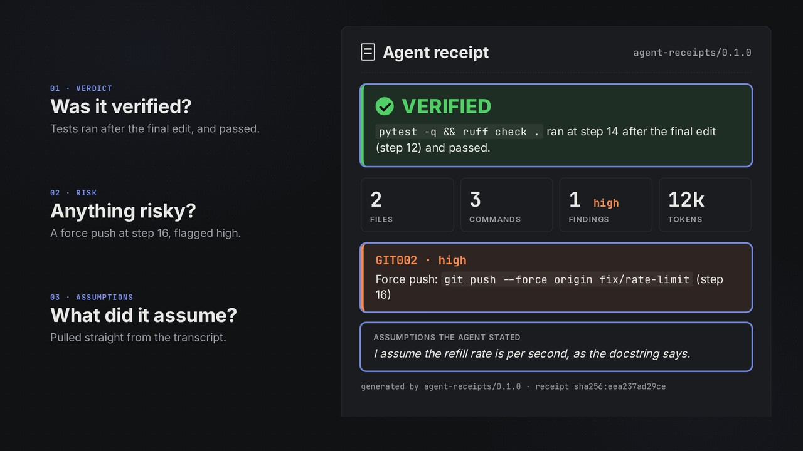

# 🧾 agent-receipts

**Show your work, agent.** A local-first CLI + GitHub Action that turns Claude Code and Codex CLI session logs into a reviewable *receipt* for every agent-authored pull request.

[](LICENSE)


[](https://github.com/AagamS06/agent-receipts/actions/workflows/ci.yml)


---

## The problem

Coding agents now write code faster than humans can review it. When an agent opens a PR, the reviewer sees the final diff — but not **what the agent ran, whether tests ran on the final code, or whether it did something risky along the way**. That evidence already exists in local JSONL session logs; nobody turns it into something a reviewer can read in a minute.

agent-receipts reads those logs and answers four questions per PR:

1. **Was it verified?** `VERIFIED` · `STALE` (tests ran before the last edit) · `FAILED` · `UNVERIFIED`
2. **Did anything risky happen?** `rm -rf`, force-push, `.env` reads, `curl | sh`, DB drops, CI edits…
3. **What did it assume?** Agent-stated assumptions, pulled out of the transcript.
4. **What did it use and cost?** Tools, MCP servers and tokens across Claude Code and Codex.

### Who it helps

Solo devs and small teams who let agents open PRs, reviewers who want a consistent evidence bar, and OSS maintainers receiving agent-generated contributions.

### Where the idea came from

Built from a gap analysis of YC **Fall 2026** and **Summer 2026** companies. The same pain points showed up again and again in their public descriptions: the verification bottleneck (Workers IO, Simulithic, GitCafe), silent destructive actions (Agent FM, Decawork, machine0, OneCLI), no cross-harness view of tool usage (Codag, Executor), babysitting many agents (Herdr, Hoplite) and debugging AI-written code (HyperProbe). This is an independent student project and is not affiliated with or endorsed by any of them. Full analysis: [PRD.md](PRD.md).

## Features

| | v0.2.0 | Later |
|---|---|---|
| Claude Code + Codex CLI adapters (rollout files and `codex exec --json`) → one event schema | ✅ | Gemini CLI, Aider, Cursor |
| Verification verdict: `VERIFIED` / `STALE` / `FAILED` / `UNVERIFIED`, with the reason | ✅ | hunk → step attribution |
| 19 deterministic risk rules (FS, GIT, SEC, NET, PERM, DB, CI) + `.agent-receipts.toml` overrides and project rules | ✅ | more rules, org policy packs |
| Secret redaction (key patterns, entropy, home paths, truncation) before any output | ✅ | |
| Markdown (PR comment) and JSON receipts, `scan` table of recent sessions; `render` also re-renders a saved JSON receipt | ✅ | HTML timeline |
| Published JSON Schema for receipts (`schema/receipt.v1.json`, `agent-receipts schema`) | ✅ (0.1.1) | |
| Session matching by repo **or by edited files**: `--touching FILE`, `--changed-since origin/main` | ✅ (0.1.1) | |
| Stated-assumption extraction, tool / MCP / token summary | ✅ | |
| Claude skill (`skills/agent-receipts/`) | ✅ | |
| `publish --pr N`: one sticky PR comment, created once and updated in place, via your `gh` login | ✅ (0.2.0) | |
| GitHub Action (`AagamS06/agent-receipts/action`) that posts a committed receipt on every PR | ✅ (0.2.0) | receipts from CI artifacts |
| PR-comment injection hardening: agent text can't @mention, link, or inject HTML/Markdown | ✅ (0.2.0) | |

## Tech stack

Python 3.11+ · Typer · Pydantic v2 · Rich · Jinja2 · pytest · ruff · mypy (`--strict`, enforced in CI) · GitHub Actions. No backend, no database, no LLM calls. Reasons in [Architecture.md](Architecture.md#4-tech-stack-and-why).

## Getting started

```bash
pip install "git+https://github.com/AagamS06/agent-receipts.git@v0.2.0"   # or: pipx install ...

agent-receipts scan --since 24h                 # recent Claude Code / Codex sessions + verdicts
agent-receipts render                           # receipt for the latest session in this repo
agent-receipts render ~/.claude/projects/<dir>/<session>.jsonl -o receipt.md
agent-receipts render --all --since 2h -f json  # combine every session in the window
agent-receipts render --all --changed-since origin/main   # every session that edited a file in this PR
agent-receipts scan --repo . --touching src/app.py        # sessions that edited one file
agent-receipts publish --pr 12 --all --changed-since origin/main   # post/update the receipt on PR #12 (uses gh)
agent-receipts schema -o receipt.v1.json        # JSON Schema for `-f json` receipts
agent-receipts rules                            # list the built-in rules
```

Try it without any logs of your own, using the example sessions in the repo:

```bash
git clone https://github.com/AagamS06/agent-receipts.git && cd agent-receipts
pip install -e ".[dev]"
agent-receipts render examples/claude-code-session.jsonl
agent-receipts render examples/codex-rollout.jsonl
pytest
```

Real output for `examples/claude-code-session.jsonl`:

```markdown
### 🧾 Agent receipt — ✔ VERIFIED
`pytest -q && ruff check .` ran at step 14 after the final edit (step 12) and passed.

| Files | Commands | Findings | Tokens |
|---|---|---|---|
| 2 | 3 | 1 high | 12k |

> [!WARNING]
> **GIT002 · high** — Force push: `git push --force origin fix/rate-limit` (step 16)
```

Exit codes (for scripts and CI): `0` clean · `1` checks failed, or a finding at/above `fail_on` (default `high`) · `2` bad input · `3` no session found · `4` (`publish` only) could not post to GitHub.

### Which sessions belong to my PR?

A session counts for a repo when it **ran inside the repo, or edited a file inside it** (agents started one folder up, or in another worktree, are no longer missed). `--changed-since <ref>` then keeps only sessions that edited at least one file changed since that git ref (committed, uncommitted and untracked), so `render --all --changed-since origin/main` gives one receipt for exactly the agent work behind a branch. `--touching <file>` (repeatable) does the same for files you name. `scan` shows an **Edits here** column with how many files each session edited inside the repo.

### Receipt JSON Schema

`-f json` output follows [`schema/receipt.v1.json`](schema/receipt.v1.json) (JSON Schema draft 2020-12, generated from the pydantic models, checked in CI). Validate a receipt in CI or another tool:

```bash
agent-receipts render -f json -o receipt.json || true
python -c "import json, jsonschema; jsonschema.validate(json.load(open('receipt.json')), json.load(open('schema/receipt.v1.json')))"   # pip install jsonschema
```

## Put the receipt on the pull request

### From your machine: `publish`

Session logs live on your machine, so the simplest path is to post from there. `publish` takes the same inputs as `render` (session files, `--all`, `--changed-since`, or a saved `.json` receipt) and uses your [GitHub CLI](https://cli.github.com) login (`gh auth login`):

```bash
agent-receipts publish --pr 12 --all --changed-since origin/main      # repo detected by gh
agent-receipts publish receipt.json --pr 12 --gh-repo you/your-repo    # from a saved receipt
agent-receipts publish --pr 12 --all --changed-since origin/main --dry-run   # print, don't post
```

It keeps **one** comment per PR: the first run creates it, later runs update it in place (it only ever edits a receipt comment written by the same account, never someone else's). Only the redacted Markdown receipt is sent; raw logs never leave your machine. `publish` exits like `render` after posting (add `--no-fail` to always exit 0), or `4` when posting failed.

Real `--dry-run` output for `examples/claude-code-session.jsonl`:

```text
[dry run] would create or update the receipt comment on you/your-repo #12:
<!-- agent-receipts -->
### 🧾 Agent receipt — ✔ VERIFIED
`pytest -q && ruff check .` ran at step 14 after the final edit (step 12) and passed.
```

### In CI: the GitHub Action

Commit the receipt with the agent's work, and let the Action post it on every PR:

```bash
agent-receipts render --all --changed-since origin/main -f json -o .agent-receipts/receipt.json
git add .agent-receipts/receipt.json
```

```yaml
# .github/workflows/agent-receipt.yml  (full example: examples/agent-receipts-workflow.yml)
on: pull_request
permissions:
  contents: read
  pull-requests: write
jobs:
  receipt:
    runs-on: ubuntu-latest
    steps:
      - uses: actions/checkout@v4
      - uses: AagamS06/agent-receipts/action@v0.2.0
        with:
          receipt: .agent-receipts/receipt.json   # default
          require-receipt: "false"                # "true": every PR must carry a receipt
          fail-on-findings: "false"               # "true": fail the job on FAILED / high findings
```

Outputs: `verdict` and `posted`. The Action installs the agent-receipts version it was pinned to, re-redacts the receipt and re-renders it with the hardened renderer, so a hand-edited JSON can't inject anything into the comment. Pull requests **from forks** get a read-only token, so the comment can't be posted there (the step fails with a clear message); use `publish` from your machine instead.

### Safe to post

Everything taken from a session log is treated as untrusted. In the Markdown receipt, agent text is collapsed to one line, raw HTML is escaped, `@mentions` are defused (nobody gets pinged), links and URLs become inert code, and Markdown punctuation is escaped, so a log can't fake a heading, a table row, an "approved" note or the receipt marker. Long receipts are capped (100 files, 50 extra findings) to stay under GitHub's comment limit.

Optional: copy `.agent-receipts.example.toml` to `.agent-receipts.toml` in your project to add your own test commands, change rule severities or add project rules.

## Use it with Claude (skill)

1. Download **`agent-receipts-skill.zip`** from the [latest release](https://github.com/AagamS06/agent-receipts/releases/latest) (or copy `skills/agent-receipts/`).
2. Unzip it and add the `agent-receipts` folder as a skill in Claude.
3. Ask: *"Make a receipt for the agent session that wrote this branch."* or *"Post the receipt on PR 12."*

## Launch video

**Built It. Bragging About It. · Ep. 5 — agent-receipts v0.1.0** (38 s: the problem, then the solution)

[](https://github.com/AagamS06/agent-receipts/releases/download/v0.1.0/agent-receipts-ep5.mp4)

[Full episode](https://github.com/AagamS06/agent-receipts/releases/download/v0.1.0/agent-receipts-ep5.mp4) (on the v0.1.0 release) · [Clip 1: the problem](docs/media/agent-receipts-ep5-clip1.mp4) · [Clip 2: the solution](docs/media/agent-receipts-ep5-clip2.mp4) · [Plan](docs/media/agent-receipts-ep5-plan.md)

## Project structure

```
src/agent_receipts/   cli · models · schema · discovery · classify · verify · receipt · redact · policy · github
  adapters/           claude_code · codex
  risk/               rule engine + built-in rules
  render/             Markdown + JSON
tests/                fixtures (synthetic sessions) + unit tests
examples/             sample sessions to try the CLI on
schema/               receipt.v1.json (generated JSON Schema)
action/action.yml     composite GitHub Action (sticky PR comment)
skills/agent-receipts/SKILL.md
```
Full tree in [Architecture.md](Architecture.md#3-folder-and-file-structure).

## Roadmap

Done: Phase 0 Setup, Phase 1 Ingest + verification (incl. touched-files matching, 0.1.1), most of Phase 2 (risk, redaction, Markdown/JSON, JSON Schema, `mypy --strict`), the core of Phase 3 (`publish --pr`, GitHub Action, injection hardening; 0.2.0). Next: tamper-evident receipt footer, fuzz tests, more rules, docs → Phase 4 Launch. Checklists and exit criteria in [Phases.md](Phases.md).

## Docs

| Doc | What's inside |
|---|---|
| [PRD.md](PRD.md) | Problem, gaps (with source companies), users, stories, features, metrics |
| [Architecture.md](Architecture.md) | Flow diagram, modules, file tree, stack, data model, log formats |
| [Rules.md](Rules.md) | Conventions, approved libs, AI-contributor boundaries, testing, security |
| [Phases.md](Phases.md) | Phase-by-phase tasks and exit criteria |
| [Design.md](Design.md) | Palette, themes, typography, components, accessibility |
| [Memory.md](Memory.md) | Short handoff: decisions, status, next steps |
| [skills/agent-receipts/SKILL.md](skills/agent-receipts/SKILL.md) | Claude skill |

## Contributing

Issues and PRs welcome — including ones written by agents, as long as they follow [Rules.md](Rules.md) (and ideally come with their own receipt). Please don't include real session logs or secrets in issues; use anonymised snippets.

## Licence

[MIT](LICENSE) © 2026 Aagam Shah
